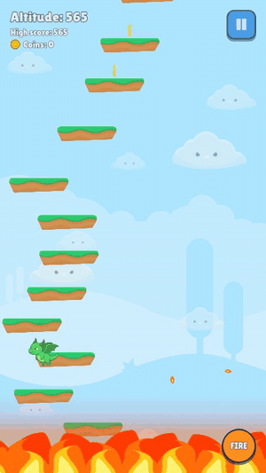

# Dragon Jump

A casual 2D vertical platformer inspired by Doodle Jump: guide a brave dragon ever upward across platforms, dodge enemies, breathe fire and grab coins.

### [▶ Play in your browser](https://bugrackm.github.io/Dragon-Jump/)

No install needed. Works on desktop and mobile browsers.

<p align="center">
  
</p>

## Controls

| Action | Keyboard | Touch |
| --- | --- | --- |
| Move | Left / Right arrows | Hold the left/right half of the screen |
| Double jump | Double-press Space | Double tap |
| Glide | Hold Space | Double tap and hold |
| Fire breath | F | FIRE button |
| Back / pause | Esc | Pause button |

Double jump and glide are unlocked with coins in the shop.

## Tech Stack

- **Engine:** Godot 4.7 (Compatibility renderer)
- **Language:** GDScript
- **Target:** Web (GitHub Pages)

## Running locally

Open the project in Godot 4.7 and press Play.

## Web build

The live build is published from the `gh-pages` branch. To rebuild it (Web export templates for 4.7.1 must be installed):

```sh
godot --headless --export-release "Web" build/web/index.html
```

The preset is single-threaded on purpose: GitHub Pages cannot send the COOP/COEP headers that threaded web builds need.

## Contributing

Issues and pull requests are welcome.

## License

The code and the project's original artwork are released under the [MIT License](LICENSE).
Third-party assets (Kenney packs, fonts, music) keep their own licenses, listed in [docs/CREDITS.md](docs/CREDITS.md).
